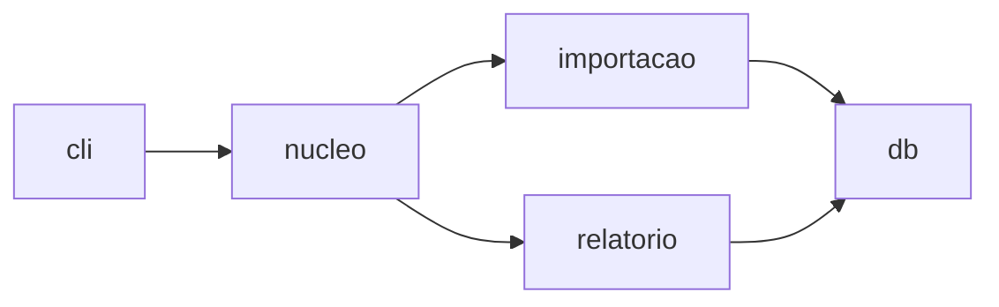
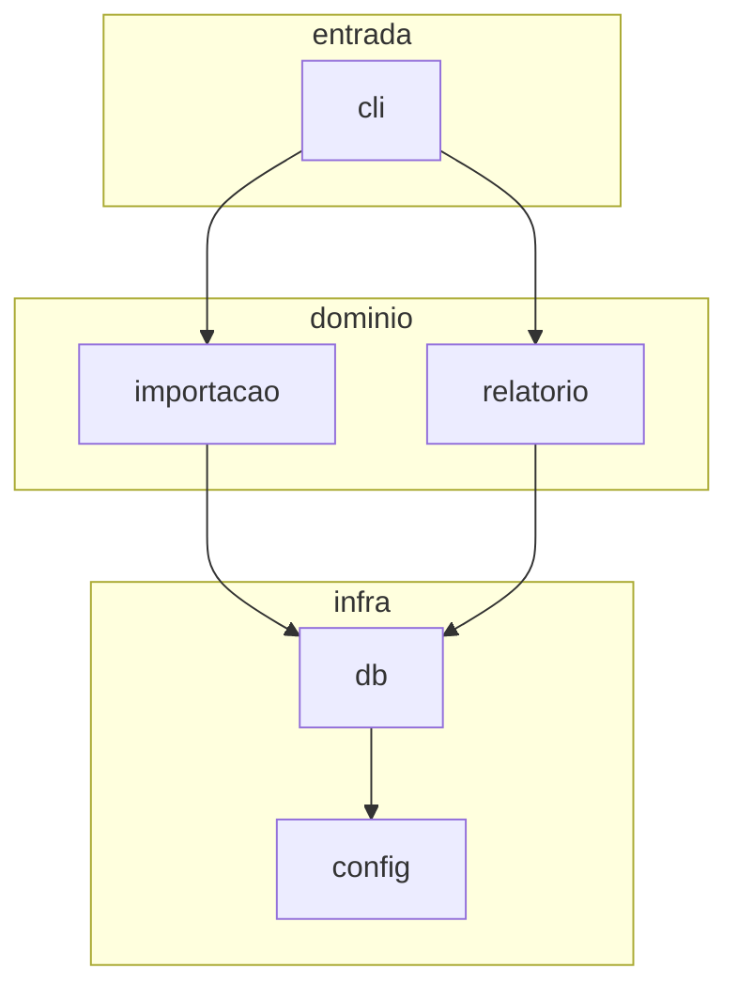
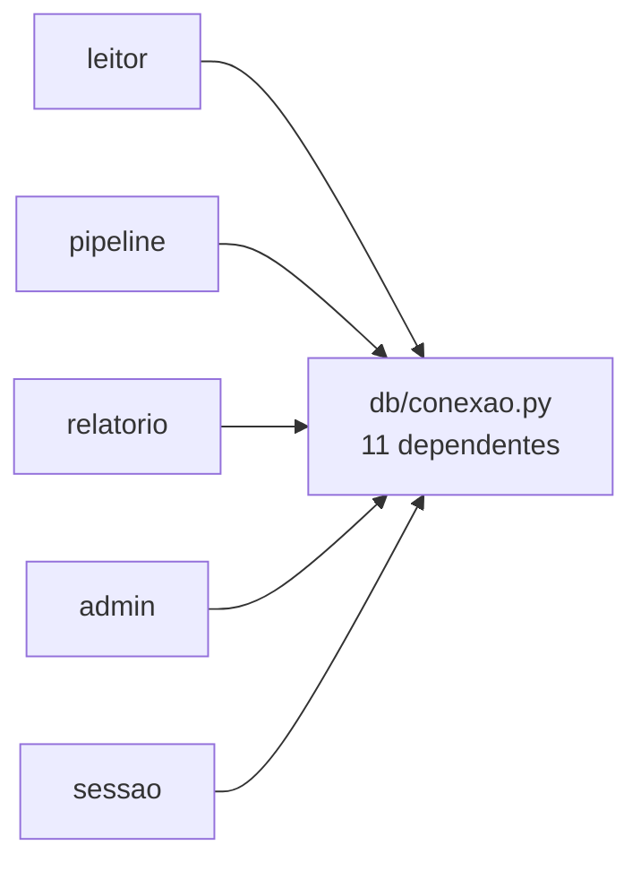
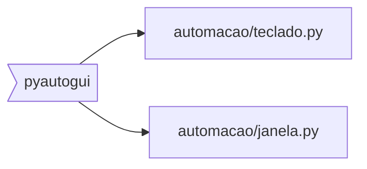
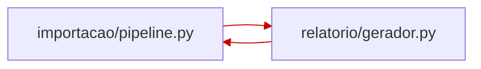

# Mapa de Módulos

Produz `[[DOC_MAPA]]` — o grafo concreto de quem importa quem, e de quais
arquivos cada dependência externa afeta.

Existe para responder, sem varredura, três perguntas que aparecem em quase toda
tarefa:

1. *Onde mexo para alterar X?*
2. *Se eu mudar este arquivo, o que quebra?*
3. *Quais arquivos essa biblioteca afeta?*

Sem o mapa, cada uma custa uma varredura da base. Com ele, custa uma leitura.

---

## Como se diferencia de `[[DOC_ARQUITETURA]]`

| | `[[DOC_ARQUITETURA]]` | `[[DOC_MAPA]]` |
| --- | --- | --- |
| Nível | Conceitual: "Importação depende de Armazenamento" | Concreto: `leitor.py` importa `db/conexao.py` |
| Origem | Decisão humana | Leitura do código |
| Muda | Quando a decisão muda | A cada commit |
| Serve para | Entender o desenho | Localizar arquivo |

Os dois coexistem. Quando divergirem, é achado: ou o código violou a
arquitetura, ou a arquitetura mudou sem registro. `[[GATE_CODE]]` § 13 trata
disso.

---

## O risco que define o desenho

**Mapa desatualizado é pior que mapa ausente.** A LLM confia, vai ao arquivo
errado, não acha, e só então varre — gastando mais do que se tivesse varrido
direto.

Três defesas, todas obrigatórias:

1. **Carimbo de validade no cabeçalho.** Data e referência do código quando foi
   gerado. Quem lê decide se confia.
2. **Atualização incremental.** Só os arquivos do diff. Varredura completa é
   para a primeira geração e para reconstrução pedida.
3. **Instrução de uso explícita no próprio arquivo.** O mapa diz como deve ser
   usado e quando deve ser ignorado. Ver seção final.

---

## Escopo

Mapeie o código-fonte do projeto. Fora do escopo:

- teste, salvo quando o objetivo declarado for cobertura;
- código gerado, `vendor/`, `node_modules/`, ambiente virtual;
- arquivo de configuração sem lógica;
- artefato de build.

Projeto grande: comece pelos diretórios de código de primeira ordem e diga o
que ficou de fora. Mapa parcial honesto vale mais que mapa completo inventado.

---

## Como ler o código

Percorra os arquivos e extraia as dependências reais. Por ecossistema:

| Linguagem | O que procurar |
| --- | --- |
| Python | `import x`, `from x import y`, `importlib`, `__init__.py` reexportando |
| JS/TS | `import`, `require`, `import()` dinâmico, reexport `export * from` |
| Rust | `use`, `mod`, `pub use` reexportando |
| Go | bloco `import`, import com `_` só por efeito colateral |
| Java/Kotlin | `import`, injeção por anotação |
| C# | `using`, injeção por contêiner |
| PHP | `use`, `require`, autoload |

### Os quatro casos em que a leitura erra

São os que uma ferramenta de análise pega e a leitura não. Trate-os
explicitamente, ou o mapa mente com confiança:

1. **Import dinâmico.** `importlib.import_module(nome)`, `require(variavel)`,
   `import()` com caminho calculado. O destino não está no texto. Registre a
   aresta como **incerta** e diga onde o nome é decidido.

2. **Reexportação.** `__init__.py` que reexporta, barril `index.ts`,
   `pub use`. Quem importa o pacote depende do arquivo interno, não do
   intermediário. Registre a dependência real e anote o caminho.

3. **Injeção e registro.** Contêiner de injeção, sistema de plugins, registro
   por decorador, ligação por configuração. Não há import, mas há acoplamento.
   Registre como **dependência em tempo de execução**, marcada como tal.

4. **Acoplamento sem import.** Dois módulos que leem a mesma tabela, o mesmo
   arquivo, a mesma variável de ambiente ou a mesma chave de cache. É
   acoplamento real e invisível ao grafo. Registre numa seção própria — é o
   que mais causa quebra surpresa.

**Nunca invente aresta.** Na dúvida, marque incerta e diga por quê. Aresta
inventada é exatamente o custo que este arquivo deveria evitar.

---

## Formato

```markdown
# Mapa de Módulos

Gerado por leitura do código em 2026-09-12, referência <commit ou "sem
versionador">. Arquivos mapeados: 47. Fora do escopo: tests/, scripts/.

Se o código mudou muito desde esta data, confira antes de confiar.

## Como usar

Procurando onde mexer: ache o arquivo em "Por arquivo".
Avaliando impacto de uma mudança: veja "Usado por" daquele arquivo.
Atrás de uma biblioteca: veja "Dependências externas".
Não achou o que procurava aqui: o mapa pode estar incompleto — varra o
código. Ausência neste arquivo não é prova de que não existe.

## Visão geral



Diagrama no nível de diretório. Arquivo a arquivo fica na tabela — grafo
com 47 nós não se lê.

## Camadas



Mostra se a direção das dependências respeita as camadas de
[[DOC_ARQUITETURA]]. Seta subindo de infra para domínio é violação
visível de longe — mais fácil de enxergar aqui que na tabela.

## Alcance dos pontos quentes



Um diagrama por ponto quente, mostrando só quem depende dele. É o
desenho que responde "o que quebra se eu mudar isto".

## Biblioteca externa



Vale a pena para as dependências que você cogita trocar ou remover.
Não faça para todas.

## Por arquivo

### src/importacao/leitor.py
Lê planilhas e devolve linhas normalizadas.

Importa: `src/db/conexao.py`, `src/util/texto.py`, `openpyxl`
Usado por: `src/importacao/pipeline.py`, `src/cli/comandos.py`

### src/db/conexao.py
Abre e devolve conexões. Ponto único de acesso ao banco.

Importa: `sqlite3`, `src/config.py`
Usado por: 11 arquivos — ver "Pontos quentes"

## Dependências externas

Índice reverso: qual código é afetado por cada biblioteca.

| Biblioteca | Onde é usada | Papel |
| --- | --- | --- |
| openpyxl | `importacao/leitor.py` | Leitura de xlsx |
| pyautogui | `automacao/teclado.py`, `automacao/janela.py` | Controle de UI |
| requests | `integracao/cliente.py` | HTTP |

Substituir `pyautogui` toca dois arquivos. É a pergunta que esta tabela
responde sem varredura.

## Pontos quentes

Arquivos com muitos dependentes. Mudança aqui tem alcance grande.

| Arquivo | Dependentes | Observação |
| --- | --- | --- |
| `src/db/conexao.py` | 11 | Ponto único de acesso; alterar assinatura toca tudo |
| `src/util/texto.py` | 8 | Utilitário estável |

## Ciclos



Só existe quando houver ciclo. `[[GATE_CODE]]` § 12 trata ciclo novo como
BLOCKER; o diagrama serve para os preexistentes ainda não resolvidos.

## Arestas incertas

Dependências que a leitura do código não resolve com certeza.

| Origem | Destino | Por quê |
| --- | --- | --- |
| `plugins/carregador.py` | indeterminado | `importlib` com nome vindo de config |
| `cli/comandos.py` | `importacao/*` | Registro por decorador, sem import direto |

## Acoplamento sem import

Módulos ligados por recurso compartilhado, invisíveis no grafo.

| Recurso | Quem toca | Risco |
| --- | --- | --- |
| tabela `usuarios` | `auth/sessao.py`, `admin/painel.py` | Migração afeta os dois |
| env `API_TOKEN` | `integracao/cliente.py`, `cli/config.py` | Renomear quebra os dois |

## Órfãos

Arquivos que ninguém importa. Podem ser ponto de entrada legítimo, ou
código morto.

| Arquivo | Provável |
| --- | --- |
| `src/cli/principal.py` | Ponto de entrada |
| `src/util/antigo.py` | Código morto — verificar |
```

Adapte as seções ao projeto. Seção vazia não entra — projeto sem dependência
externa não tem a tabela de externas.

### Regras dos diagramas

**Diagrama é recorte, nunca despejo.** Grafo Mermaid com mais de ~15 nós vira
emaranhado que ninguém lê, e a tabela passa a ser mais rápida. Se não couber
legível, divida por subgrafo ou deixe só a tabela.

- **Visão geral:** nível de diretório ou módulo, nunca arquivo a arquivo.
- **Ponto quente:** um por arquivo crítico, mostrando apenas seus dependentes.
- **Camadas:** `subgraph` por camada, para que violação de direção salte aos
  olhos.
- **Ciclo:** só quando existir.
- **Externa:** só para biblioteca que você cogita trocar.

Rotule o nó com o caminho real quando o nome curto for ambíguo —
`db/conexao.py`, não `conexao`. Duas coisas chamadas `utils` em diretórios
diferentes é o caso comum.

Mantenha os nomes dos nós iguais aos das tabelas. Diagrama que chama de
`importacao` o que a tabela chama de `src/importacao/pipeline.py` obriga a
tradução mental a cada consulta.

Toda aresta do diagrama existe nas tabelas. O diagrama é outra vista dos mesmos
dados, não um segundo conjunto de fatos que pode divergir.

---

## Atualização incremental

O modo normal. Varredura completa só na primeira vez, ou quando pedida.

Entrada: os arquivos do diff.

1. Para cada arquivo alterado, releia os imports e atualize sua entrada.
2. **Atualize os dois lados.** Aresta removida sai também do "Usado por" do
   outro. É o erro mais comum, e produz exatamente a mentira que o mapa deveria
   evitar.
3. Arquivo novo ganha entrada; arquivo removido sai, inclusive das listas
   "Usado por" onde aparecia.
4. Dependência externa nova ou removida atualiza a tabela de externas.
5. Recalcule pontos quentes e órfãos apenas se a contagem mudou.
6. Atualize o carimbo do cabeçalho.

Custo proporcional ao diff, não à base.

---

## Integração com o gate

`[[GATE_CODE]]` § 12 já executa análise de dependências para detectar ciclos.
A verificação do mapa aproveita essa passagem:

- diff alterou import, arquivo novo, arquivo removido ou dependência externa →
  `[[DOC_MAPA]]` precisa ter sido atualizado na mesma alteração;
- não foi → **WARNING**, com o comando de correção: executar este prompt em
  modo incremental;
- mapa contradiz o código — aresta que não existe mais, arquivo inexistente
  listado → **WARNING forte**, porque induz a LLM ao erro.

Não é BLOCKER: mapa é ferramenta de navegação, não contrato. Reprovar uma fase
por causa dele seria desproporcional. Mas WARNING reincidente escala, pela
regra geral do gate.

---

## Uso pela LLM

O propósito é economizar busca. Para isso o mapa precisa ser consultado antes
da varredura, e para isso precisa estar apontado em `[[DOC_DIRETRIZES]]`:

```markdown
### Onde procurar

Antes de varrer a base atrás de um arquivo, consulte <caminho do mapa>:
quem importa quem, quais arquivos cada biblioteca afeta, e quais são os
pontos de maior alcance.

Confira o carimbo de validade no topo. Se o código mudou muito desde a
geração, ou se o que você procura não está lá, varra — o mapa pode estar
incompleto, e ausência nele não é prova de inexistência.
```

Isso fecha o encadeamento: `CLAUDE.md` ou `AGENTS.md` → `[[DOC_DIRETRIZES]]` →
mapa → arquivo certo.

---

## Saída

```text
MAPA DE MÓDULOS
Modo: completo | incremental
Arquivos mapeados: N     Fora do escopo: lista
Arestas: N (incertas: N)
Dependências externas: N
Pontos quentes: lista
Órfãos: N
Acoplamento sem import: N
Carimbo: data e referência
```
